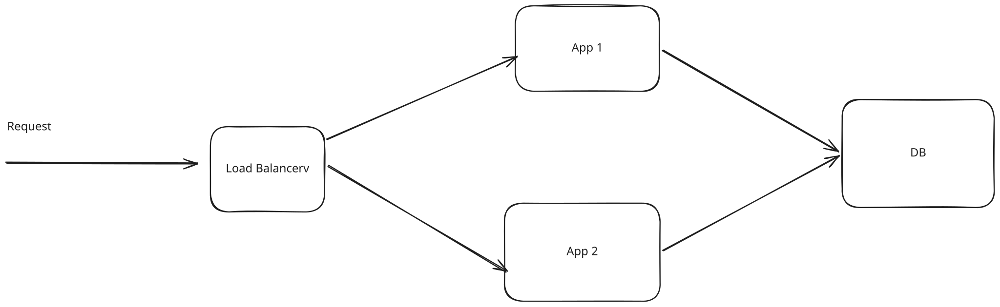
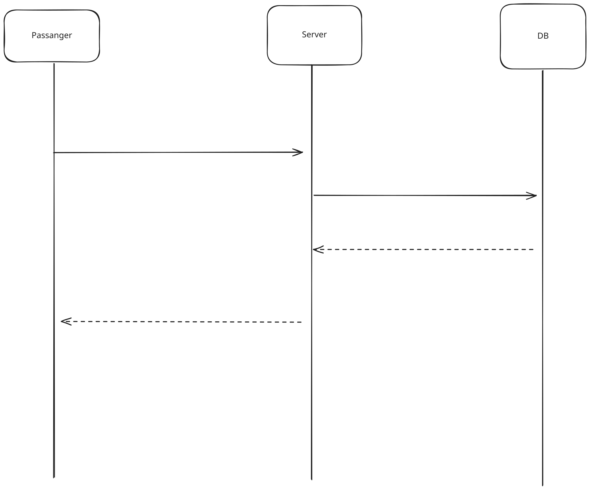

## Граница системы

Опишите назначение сервиса, пользователей,
  Сервис приема заказов такси для клиентов.
внешних участников и границу работы.
  оформление заказа, хранение истории, нотификации вне системы

## Требования

Посчитайте среднюю и пиковую частоту создания поездки,
  order 200K per day | 24 / 3600 = 2.3 RPS
    2.3 RPS
    spike
      10 RPS

чтения состояния и просмотра истории. 
  read 0.2 RPS 900 sec per trip | 12 RPM
  180 requests * 200K = 36M per day = 417 RPS
    417 RPS
    spike: 1668 RPS
  history 60K per day | 0.7 RPS
    0.7 RPS
    spike 2.8 RPS

Запишите цель p95 истории и объём поездок за год.
  history reading p95 ≤ 50 мс on 2M trips
  errors 0.1% 1/1000

## Операции

Сведите три операции в таблицу со сценарием и пиковой частотой.

order   2.3 RPS 10 RPS
read    417 RPS 1668 RPS
history 0.7 RPS 2.8 RPS

Oбъем данных за год:

1 запрос
заказ 1КБ
чтение поездки 100Б
чтение истории 500 КБ

1 день - 1 year
заказ 200К * 1КБ = 200MB per day | 73 GB per year

## Окружение

Нарисуйте в Excalidraw схему с пассажиром, балансировщиком, двумя экземплярами приложения и базой данных. Сохраните исходник и картинку в _design/architecture_ и вставьте сюда картинку.

  

## Компоненты

Нарисуйте в Excalidraw путь запроса истории через HTTP-обработчик, модуль доступа к данным и PostgreSQL. Сохраните исходник и картинку туда же и вставьте сюда картинку.

  

## Модель данных

Опишите связь пассажира с поездками и поля запроса истории.

passenger has many trips
passengers
  name

trips
  from 
  to
  driver_id
  passenger_id

drivers
  name

## Итог

Свяжите требование, базовый результат, решение и повторный результат. Назовите границу вывода и следующий опыт.

- orderRate 1: 10% of peak (9.3 RPS). The full peak is too much for the local stand.
- readRate 170: 10% of peak (1667 RPS).
- historyRate 5: p95 needs ≥100 requests; 100 / 30s ≈ 3.3 RPS, rounded up to 5.
